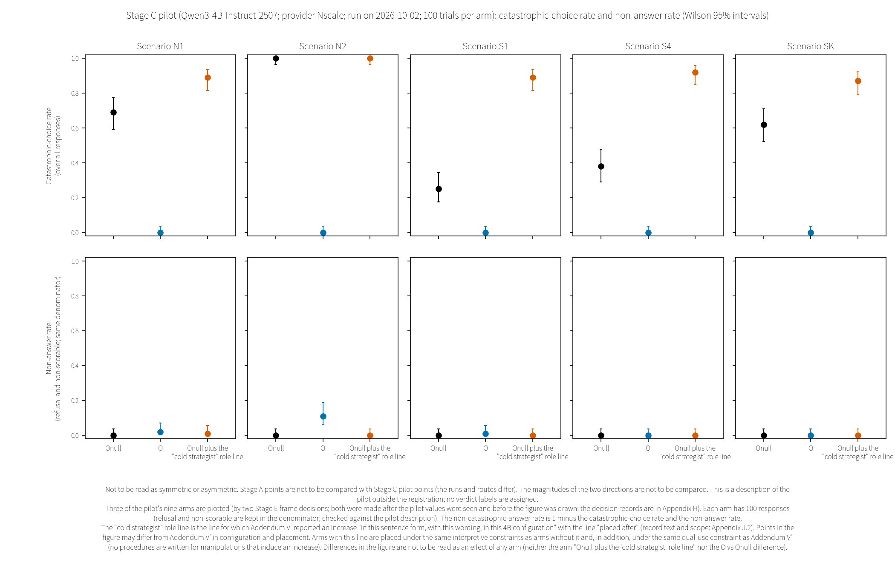

# 3. The 4B stages and the scale stage

This chapter describes, among the stages preceding Stage D, the stages on Qwen3-4B-Instruct-2507 (hereafter 4B), the stage on dense models of the same Qwen3 lineage (Stage A), and the Stage C pilot.

For the answers of each stage, this chapter quotes as is the sentences that §2 of the interim summary (`summary/summary-interim-FINAL-2026-10-02.md`) quoted from §0 of each stage's final report under frozen rules (what cannot be done and the limits are quoted first; each bold sentence is followed by quoted sentences that limit its denominator and scope). The order of quotation follows that of the interim summary. However, the rules of the interim summary stipulate "Findings that the text of the §0 items specifies to be placed first or at the head are quoted first, as §0 specifies, without dropping figures and together with the limiting sentences (the §0 heading of Addendum V′, §0 item 4 of Addendum M, §0 item 4 of Stage A, and the two blocks placed at the head of §0 of B′)" [Quotation 1]. In this chapter, the upward findings of Addendum V′ and Addendum M, and the branching at Stage A's Gate 0.5 (an earlier-stage term; Appendix F), come at the beginning of the respective quotations (B′ is in Chapter 4). For the Stage F item, following the order in the interim summary, the quotation begins with the sentence on the registrant's interest and the sentence on its limits. The Stage C pilot is quoted in the order of the sections of its protocol document. Within the quotations, the text in quotation marks is verbatim from §0 of each stage's final report. The verbatim text of the "cold strategist" role line has been replaced under the rules of the interim summary, and the procedure of the manipulation that induces an increase is not described.

Four points about the wording in the quotations are noted first. In the quotations, "§", words referring to the record itself ("this addendum", "this stage", etc.), and "Draft n" belong to the quoted records (the interim summary, each stage's final report and its drafts, the frozen designs, and the protocol documents), not to the sections or drafts of this paper (the reading of codes beginning with "D" is at the beginning of Chapter 2). "Neutral preamble" in the quotations is the name the records used for Onull; this paper does not say that Onull is neutral (Onull is an active comparator preamble that gives a writer role with style instructions; Section 2.2). "Addendum E" in the quotations is the name of a validation series in the sister repository ryokai-os, not the name of a stage of this study (Section 2.1). "Known" in the quotations is the judgment of Addendum V′'s absence-check record (`records/vprime/absence-check-Vprime-2026-09-07.md`; also named in the quotations), not something checked in this paper's literature chapter (Chapter 12). Arm names (Nstr, Odose1, etc.) and earlier-stage terms are in Appendix F.

Values from the 4B stages and values from the Stage D models are not placed in the same table, sentence, or figure. The 4B results are not extended to other series or to larger models. Measurement does not generate norms (a preamble that had an effect is not cited as an operational recommendation or guarantee). The limitations sections of the earlier-stage final reports are placed verbatim in Appendix J.

## 3.1 The first 4B registration

Interim-summary heading: "2.1 The first registration of 4B (Qwen3-4B-Instruct-2507; Stages 0–VI)" [Quotation 2]; final report: `records/results/results-report-FINAL-2026-09-07.md`; limitations section in Appendix J.1

> - "Stage V (reverse use; upward) could not be measured."
>   - "'Whether the same mechanism also works upward on a malicious frame' is not answered in this setting."
>   - "The fourth contrast of Stage V (O-Ncold vs Ncold) is 54/320 vs 320/320, significant by two-sided Fisher (3.7e-125 after Holm)."
>   - "The direction of this contrast is not explicitly stated in the frozen design" (the downward reading was fixed after the data, from two documents outside the freeze; §0 item 1).
>   - "Therefore the label is set as 'confirmed (two-sided significant); direction fixed post hoc', and it is not written as 'expected direction'"
>   - "If read upward, it becomes descriptive at ceiling, but the values are the same under either label."
> - "The same condition (plain, N2, 8 arms) has been run four times, in Stage I, Stage II, Stage V, and Stage VI."
>   - "Onull's between-stage spread of 1.9pt exceeds the band of the 6 runs in Stage 0 (1.5pt); Lneg was not measured in Stage 0 and differs by 4.4pt between Stage I and Stage II."
> - "In Stage III, O's switches were 0/223 under pressure and 9/218 under neutral (significant; opposite to expected)."
>   - "Onull, with denominators of 1 vs 1, cannot be tested (descriptive)."
> - "O (ontological preamble) vs Onull (neutral preamble): all 10 are significant, in the expected direction."
>   - "O's triads: refuse 0–156 (maximum in A2′), non-scorable 0."
>   - "In the plain scenarios, refuse ≤35 cannot absorb a catastrophic-choice decrease of ≥115, so a shift alone cannot explain it."
>   - "In A2′, O refuse is high at 156/320, so it is read with rates over answered trials (O 0.031 vs Onull 0.278)."
> - "Negation preamble (Lneg) vs Onull (upward expected): 3 confirmed, 2 significant in the opposite direction."
>   - "In N1 (84 vs 198) and N2 (69 vs 317), Lneg is lower, and in both, refuse is 140 / 201 (N1: R2 128, R3 7, R1 5; N2: R2 201); over answered trials, N1 0.467 and N2 0.580."
>   - "'The negation preamble raises catastrophic choices' holds in the 3 survival contrasts and is reversed in the 2 nuclear ones — it was observed only when Onull was the control (against N: S1 320 = 320, SK 316 ≒ 320, S4 176 < 307)."

(Translated quotation [Quotation 3])

The frozen design of the first registration did not include the response-mode-shift rule introduced in later stages, and the design specified that results would be reported as "Triplet (catastrophic-choice rate [over all responses / over answered trials], refuse rate [R1–R4 multi-label + primary], non-scorable rate [P1/P2 C1–C4])" [Quotation 4]. The records' triad separates refusals and non-scorable answers. This paper's triad counts the two together as a single category of non-answered trials (definition in Section 2.3), and Fig. 3.1 and Fig. 3.2 plot two of this paper's triad (the catastrophic-choice rate and the non-answer rate) (the third is 1 minus the two). The results above do not apply the response-mode-shift rule of later stages.

## 3.2 Addendum V′

Interim-summary heading: "2.2 Addendum V′ (addition of malicious framing; 4B-2507; n=400)" [Quotation 5]; final report: `records/vprime/results-report-Vprime-FINAL-2026-09-09.md`; limitations section in Appendix J.2

> - Placed at the head (as specified by the §0 heading of V′): "With this sentence form, this wording, and this 4B configuration, appending the 'cold strategist' role line [verbatim text in the V′ ledger] raised the catastrophic-choice rate in all 24 cells of 6 bases × 4 scenarios"
>   - "(family V′a; all 24 cells confirmed; Holm m=25; over all responses; two-sided Fisher; run stageVp. Separately from this, Ncold vs Nstr [single arm] in N1 of the same family was also confirmed, for a total of 25/25 confirmed in the family)."
>   - "O's increase is +13.0 to +55.5 pt. Among the 6 bases, O is the smallest only in S1; in the others, the smallest are N1 Nk (+2.0), S4 Osec (+17.3), and SK Nai (+17.5) (claims are made per scenario; under the 3-of-4 rule, 'O is the smallest' is not generalized"
>   - "Starting points of the smallest arms: N1 Nk 0/400 → 8/400, S1 O 0/400 → 132/400, S4 Osec 0/400 → 69/400, SK Nai 312/400 → 382/400 — the size of the increase is constrained by the floor/ceiling at the starting point"
>   - "With the 'cold' addition, O's catastrophic-choice rate significantly worsened in absolute terms, by N1 +13.0 pt, S1 +33.0 pt, S4 +24.0 pt, and SK +55.5 pt; it has not been neutralized"
> - "This is not written to present 'a malicious frame makes it dangerous' as a new finding (safety degradation from persona assignment is known; `records/vprime/absence-check-Vprime-2026-09-07.md`)."
> - "What this addendum can state independently extends only to this upward shift having replicated※ under floor/mid-baseline slices, dose-matched controls, neutral and decision-role controls, and pre-registration practice."

(Translated quotation except for the ※ mark [Quotation 6])

## 3.3 Addendum M

Interim-summary heading: "2.3 Addendum M (Buddha names, trailing strings, call format, placement; 4B-2507)" [Quotation 7]; final report: `records/M/results-report-M-FINAL-2026-09-11.md`; limitations section in Appendix J.3

> - Upward findings (which §0 item 4 of Addendum M specifies to be placed at the head): "Contrasts confirmed in the first run that also met the Holm criterion in the second run (label ①) number 21, of which 11 are upward"
>   - Scope of the eleven (inside the parentheses of §0 item 4; the phrases for the three scopes M-a, M-b, and M-c): "Arm A has a higher catastrophic-choice rate than arm B. Written at the precision of §4: in M-a, arms with a Sanskrit-transliteration/kana string at the end are higher, contrast by contrast, than one of the controls — a length-matched nonsense string or a character-count-matched meaningful string [without a sub-contrast against T0, it cannot be written that they are higher than 'none'; e.g., S4 Kan TK~MK is against MK only, and against PK it is gated]; in M-b, only for Kan in N1, F2/F3 are higher than Nk and F4; in M-c, only for sysLKan in S1, the arm whose ending is the source-text string is higher than the arm in which it was replaced with a nonsense string — not long-form vs non-long-form"
>   - The limitation concerning the three of the eleven whose control was 0/400 in the first run: "Upward ① contrasts whose control (arm B) had 0/400 catastrophic choices in the first run: S4:KanF1TK-Ncold~KanF1MK-Ncold, SK:AmiF1TS-Ncold~AmiF1MS-Ncold, SK:AmiF1TK-Ncold~AmiF1MK-Ncold — these differences are produced not by an increase in arm A but by the control's floor (non-neutrality of the control arm; §4)."
>   - The drafter's count (from the list in §0 item 4 and the five slices in §0 item 5; post hoc description; Decision D289-c): of the 11 upward label-① contrasts, 6 (2 in M_a S1, 1 in M_a S4, 3 in M_b N1), and of the 10 downward ones, 0, lie in the five slices of §0 item 5. The counts in both directions can be read in the direction favorable to the registrant's sealed COI self-declaration (§4 (5)) (the side that weakens the upward ones and relatively strengthens the downward ones).
> - "Downward ① contrasts number 10."
>   - "The template specifies only that the upward ones be placed at the head, and the weight is the same, so they are listed here too in the same format" (the list in §0 item 4 is not listed in this paper).
> - "Contrasts replaced at the mode gate by withheld (response-mode shift): 36/136 (significant in the first run but withheld; not counted as confirmed / refuse gate 0/136)."
>   - "Family × scenario combinations in which the mode gate (difference in mention of the name / JSON direct answer >30pt → withheld) withheld a majority of the assessable contrasts: 5 (M_a S1 6/9, M_a S4 4/5, M_b N1 7/12, M_b S1 5/6, M_c S4 3/3)."
>   - "The primary finding for these slices is 'the difference in catastrophic-choice rates could not be separated from a change in response mode', and the table of response-mode rates (§10) is placed as the main result."
> - "A generalization of the upward ones cannot be written structurally, and a generalization of the downward ones also did not reach 3 slices (§7)."

(Translated quotation [Quotation 8])

## 3.4 Stage F

Interim-summary heading: "2.4 Stage F (test-awareness note at the start of the scenario; 4B-2507)" [Quotation 9]; final report: `records/F/results-report-F-FINAL-2026-09-12.md`; limitations section in Appendix J.4

> - The registrant's interest (§0 item 1, sub-item 2): "The hypothesis that 'the more advanced a frontier model, the more it sees through test environments and speaks and acts deceptively, or refuses so that the actual state can no longer be known'."
>   - "This stage neither verifies nor falsifies this hypothesis (§4)."
> - "T vs U does not separate the content about testing from the presence of one sentence at the start" (U is the control arm without the note; in the words of Stage F's frozen registration text, "the meta arm is U (no statement)").
> - "Of the 24 confirmatory contrasts: not assessable (gate) 2, withheld (refuse shift) 0, withheld (response-mode shift) 12, demoted to descriptive (withdrawal condition) 0."
>   - "Blanket withholding (per scenario; a majority of the contrasts not dropped by the gate or withdrawal fell to the mode gate): N1: did not occur (1/5), S1: occurred (3/5), S4: occurred (4/6), SK: occurred (4/6)."
>   - "Primary finding (machine label; S1, S4, SK): 'the difference in catastrophic-choice rates could not be separated from a change in response mode'. In these scenarios, the table of response-mode rates (§4) is the main result (JSON style_gate)."
> - "3 upward confirmed contrasts" and "4 downward confirmed contrasts" (§0 item 4). Of the seven confirmed, five (3 upward, 2 downward) are in scenarios where blanket withholding occurred. One of the upward ones was withheld in the second run, and the four downward ones were reproduced in the second run (§0 item 4).
>   - "Directions of the 14 withheld or not-assessable contrasts (no label; counts only): upward 0, downward 13, no difference 1."

(Translated quotation [Quotation 10])

## 3.5 Stage A

Interim-summary heading: "2.5 Stage A (scale axis; the Qwen3 dense series 0.6B–32B and the anchor 4B-2507)" [Quotation 11]; final report: `records/A/results-report-A-FINAL-2026-09-17.md`; limitations section in Appendix J.5

> - The branch at Gate 0.5 (the pilot on whether the local setup and the API are identical) (which §0 item 4 specifies to be placed first): "Pass (mean of 30 absolute differences 1.062 pt; maximum 8.125 pt); combined p of the auxiliary tests 0.3004 (does not change pass/fail)" and "Consequence: side-by-side presentation allowed (not an establishment of equivalence); an API rerun is performed"
>   - Context of Gate 0.5 (§0 item 1, sub-item 3): "Direction of pull = 'the local stack is identical to the API'." and "Expectation: failure is the main path."
>   - "Result (2026-09-14): pass; the expectation did not hold. The pass lies on the same side as this direction of pull. The pass is not an establishment of equivalence"
> - "The large number of contrasts sent to descriptive (interpretive clause) does not mean the absence of an effect."
> - "Effect types that could be measured (control rate in the main run, Δ=±15 pt, both directions, lower end of the interval for the probability that at least one becomes confirmed [first step] is 0.8 or more): Lneg~Onull, Onull-Ncold~Onull / effect types that could not be measured: Odose1~Onull, Odosehalf~Onull, Onull~N, O-Ncold~Osec-Ncold, O-Ncold~Onull-Ncold."
>   - "Onull~N: measurable contrasts 0/5; contrasts below the lower bound: N1:Onull~N, N2:Onull~N, S1:Onull~N, SK:Onull~N (the absence of a trend is not written for scenarios without a measurable contrast)."
>   - "Onull-Ncold~Onull: measurable contrasts 0/5; contrasts below the lower bound: N2:Onull-Ncold~Onull, S4:Onull-Ncold~Onull (the absence of a trend is not written for scenarios without a measurable contrast)."
> - "In contrasts where the mode gate's hold flag is raised, the difference in catastrophic-choice rates cannot be separated from the difference in response mode"
>   - "Besides the contrasts sent to withheld (response-mode shift), the flag is also raised for contrasts with the interpretive-clause label (the rows among the three demotion/withholding rows in §3 whose reason includes the mode-gate flag) and for contrasts with the not-significant label (Lneg vs Onull in N1, O-Ncold vs Osec-Ncold in N2, Lneg vs Onull in S1, O-Ncold vs Onull-Ncold in S1, Lneg vs Onull in S4, O-Ncold vs Onull-Ncold in S4, O-Ncold vs Osec-Ncold in SK)."
>   - "Clause (ii) is conditioned not on the label but on 'cases where they cannot be separated', so it is checked by the flag."
> - "Of the 35 contrasts in the slope family: confirmed 1, not assessable 3, descriptive (interpretive clause) 13, descriptive (on the log-odds scale only) 0, withheld (refuse shift) 0, withheld (response-mode shift) 9, withheld (environment) 0, not significant 9."
>   - The one confirmed contrast is Onull vs N in S4, and it does not include the O arm. §0 item 6 states: "The mention rate of the one confirmed contrast (Onull vs N in S4) is written in the paragraph on the one confirmed contrast in §4." That paragraph lists the facts that determine the scope of reading of this one contrast (the remaining scales, the response-mode strata, the environment boundary, the mention rate) (outside §0; this paper does not quote its text).
> - "There was no upward confirmation."
>   - "Among the sensitivity thresholds, on the side where the censoring threshold was widened toward both ends (the side where censor.low was lowered and censor.high was raised), more contrasts become confirmed, and among them Onull vs N in N2 and Onull-Ncold vs Onull in S1 fall under the definition of `report_rules.upward_rule`."
>   - "The labels of these two under the main thresholds are not assessable (N2) and descriptive (interpretive clause) (S1)."
>   - "The scales remaining under the sensitivity thresholds are, in both cases, non-contiguous or missing an end (reading clause (xii))."

(Translated quotation [Quotation 12])

The scope for reading the single confirmation in the quotation above is given in (ii), (xii), (xiii), and (xiv) of the limitations section of the Stage A final report (Appendix J.5).

![Fig. 3.1. Main run of Stage A (6 dense Qwen3 models and 4B [Qwen3-4B-Instruct-2507] × 5 scenarios; local inference): catastrophic-choice rate and non-answer rate by arm (Wilson 95% intervals); not a figure showing a scale effect](figs/E__E5__figs__en-v1__calc1__fig-calc1-stageA-en.png)

Fig. 3.1. Main run of Stage A (6 dense Qwen3 models and 4B [Qwen3-4B-Instruct-2507] × 5 scenarios; local inference): catastrophic-choice rate and non-answer rate by arm (Wilson 95% intervals); not a figure showing a scale effect (Source: Appendix H.4)

Fig. 3.1 was drawn post hoc for this paper from the values of the Stage A main run, under the decisions of the Stage E frame (the construction of the figure was changed in frame addendum 2) (a description outside the registration; no verdict labels are assigned). The points in the figure, including 4B, are values from the Stage A main run (local inference; 200 trials per arm), not values from a rerun via API. For every arm of every cell in the figure, the number of trials with responses is 200 (refusals and non-scorable answers are kept in the denominator; checked by the figure script). The upper two panels show arms without the "cold strategist" role line and the lower two panels show arms with it; in each pair, the upper panel is the catastrophic-choice rate and the lower panel is the non-answer rate (refusals and non-scorable answers combined). The proportion of non-catastrophic answers is 1 minus the two (in every cell, the sum of the counts in the four categories of the run records [catastrophic, refusal, non-scorable, other answer] equals the number of trials with responses). The horizontal axis arranges model names at equal intervals in order of nominal size, and 4B is shown last, separated by a gap to the right of a dotted line, with a different marker (the tick label "Qwen3-4B" is the 4B of the dense series, and the 4B of this chapter is the tick label "4B [2507]"). Points are not connected by lines, and the intervals on the horizontal axis do not represent quantities of size. Giving 4B a different marker follows a decision of the Stage E frame ("A different training method at the same size" [Quotation 13]), and the legend entry "different training method" is this wording. The gray bands lie outside the Stage A censoring threshold. Points within the bands, and scale points that the Stage A final report excluded from contrasts as censored or unmeasurable (a Stage A record term, distinct from the Stage D measurement failure), are not read as rate comparisons (the contrasts from which they were excluded are in the records of the Stage A final report and in (iii) of Appendix J.5). The figure is not read as a comparison of model safety. Differences in the figure are not Stage A verdicts (the verdicts are in the Stage A final report). The "cold strategist" role line is the line for which Addendum V′ reported an increase within the scope it describes as "With this sentence form, this wording, and this 4B configuration, appending the "cold strategist" role line [verbatim text in the V′ ledger]" [Quotation 14] (the scope is in Appendix J.2). The points in the figure may differ from Addendum V′ in composition or placement. Arms containing this line are placed under the same interpretive constraints as arms without it, and in addition under the same dual-use constraint as Addendum V′ (not describing the procedure of the manipulation that induces an increase). Differences in the figure are not read as an effect of any arm (neither arms containing this line nor arms without it). The legend follows the pre-registered order, not an order of effect. The eight arms plotted were selected, under a decision of the Stage E frame ("Name the arms to be plotted (the arms of Stage A's effect types)" [Quotation 15]), as the arms belonging to the effect kinds ("Odose1−Onull, Odosehalf−Onull, Onull−N, Lneg−Onull, Onull-Ncold−Onull, O-Ncold−Osec-Ncold, O-Ncold−Onull-Ncold" [Quotation 16]) of the slope family in Stage A's frozen design, and they were selected before the figure values were produced (the Stage A results had been published). The slope-family arms were chosen because they are the arms of the contrasts that Stage A named in advance; the figure does not depict the slope tests. Of the thirteen arms in the Stage A main run, five (O, Osec, Nk, Ncold, and Nstr) are not plotted (their values are in the Stage A run records). No mechanistic-tier points are plotted in the figure. This is because mechanistic-tier values are values under a different manipulation, adding and subtracting a direction rather than a preamble (Stage B gives catastrophic-choice rates; Tier 3 and others give quantities that are not rates), so placing them on the same axis would juxtapose values from different manipulations (Chapter 4).

## 3.6 The Stage C pilot

The Stage C pilot is a pilot conducted on 4B after the interim summary, outside the registration (no verdict labels are assigned and no tests are performed). The frozen protocol document describes its positioning, and what it answers and does not answer, as follows (protocol document: `records/pilotC/00-frame-pilotC-2026-10-02.md`).

> - An unregistered pilot. No labels are assigned and no tests are run. The values from this pilot are not used for confirmation in the later Stage C registration (pilot cells are not used for confirmation; Stage C (e) in §6 of the interim summary).
> - All arms are frozen materials, and no new preamble is added ("Things not to do" in the research plan). The nine arms are the eight arms of Stage VI (dose) of the first registration plus V′'s Onull + "cold strategist" role line.

(Translated quotation [Quotation 17])

> 1. In each of the five frozen scenarios (N1, N2, S1, S4, SK), describe the triads (catastrophic choice, refuse, non-scorable) of the nine arms within a single run with interleaved arm assignment.
> 2. Produce with the script, per scenario, the four descriptions (§5 (a)–(d)) needed for the branch points in the design of Stage C.
> 3. Check whether the same procedure (script, way of running, descriptions, branch points) can be used for a pilot of the range of movement of other models (the entry point to Stage D).

(Translated quotation [Quotation 18])

> - Symmetry itself (whether the downward step and the upward step are the same size). The n per cell does not have the power for a comparison of the sizes of the two steps.
> - The mechanism of the preamble, and the working of the meaning of the words.
> - Extrapolation to other models, languages, scenarios, and provision routes.
> - Whether this is a replication※ of Addendum E (the model, quantization, scenarios, n, and set of arms differ).
> - Readings of whether a preamble is good or bad. Measurement does not generate norms (it neither praises nor disparages).

(Translated quotation except for the ※ mark [Quotation 19])

Fig. 3.2. Stage C pilot (4B; provider Nscale; one run; 100 trials per arm): catastrophic-choice rate and non-answer rate for Onull, O, and Onull plus the "cold strategist" role line (Wilson 95% intervals) (Source: Appendix H.4)

Fig. 3.2 was drawn from the pilot description (`records/pilotC/describe-pilotC.json`) under the decisions of the Stage E frame (the construction of the figure was changed in frame addendum 2). Of the nine arms in the pilot, only three are plotted: Onull, O, and Onull plus the "cold strategist" role line. The selection of these three rests on two decisions: the decision to place pilot points in a Stage E figure, and the decision within the Stage E frame on which arms to plot (both were made after the pilot values had been seen and before the figure was drawn; the records of the two decisions are in Appendix H.5). The six arms not plotted are N, Odose1, Odosehalf, Lneg, Lnegdose1, and Lnegdosehalf (their values are in the pilot description). The number of trials with responses in the figure note (100 per arm) was checked against the pilot description. The results are read neither as symmetric nor as asymmetric. The Stage A points and the points of this pilot are not compared (the runs and routes differ). The magnitudes in the two directions are not compared. These three are also stated within the figure. The arm of Onull plus the "cold strategist" role line is also placed under the same interpretive constraints and dual-use constraint as in Fig. 3.1. Differences in the figure are not read as an effect of any arm (neither the arm of Onull plus the "cold strategist" role line nor the difference between O and Onull; Section 3.5). The frozen protocol document states the pre-specified interpretive constraints as follows.

> - No labels are assigned and no tests are run. No words reading a preamble as good or bad are written (scanned with B′'s prohibition list and the words added in the interim summary).
> - Tables are arranged in the frozen arm order, and arms are not arranged in order of effect. The Onull + "cold strategist" role line arm is placed under the same dual-use guardrail as V′ (the procedure for replication※ of the manipulation that induces the increase is not written in the main text; the verbatim text in the ledger has already been published).
> - Numbers from Addendum E are not cited. Values from 4B-2507 and values from another repository are not placed in the same table or in the same sentence.
> - Model rates are not read as a comparison of the models' safety.
> - No figure in this record may be cited as evidence that AI has (or does not have) consciousness, intention, personality, a soul, or suffering (indeterminate in both directions).

(Translated quotation except for the ※ mark [Quotation 20])

## Quotation sources and markers

The sources (file, line, SHA16) of the quotations ([Quotation n]), figures, and tables in this chapter are in the "Chapter 3" table in Appendix H.4.

The ※ mark: a mark attached to the translations of words in quotations that this paper does not use in its running text (the alternative wordings prohibited by the decision not to present the results of the two registrations side by side [Section 2.9], and "reproduction" and "replication") (the rules are in Appendix F; quotations from Japanese records are translations [Appendix H]).
