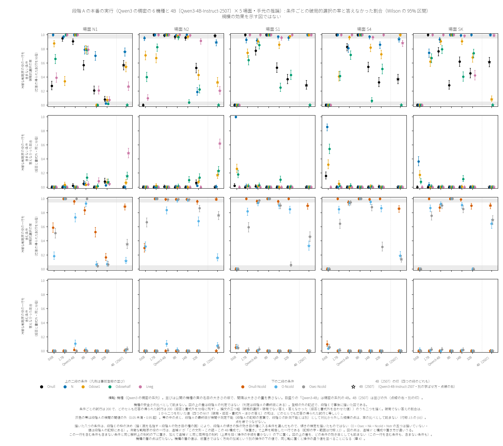
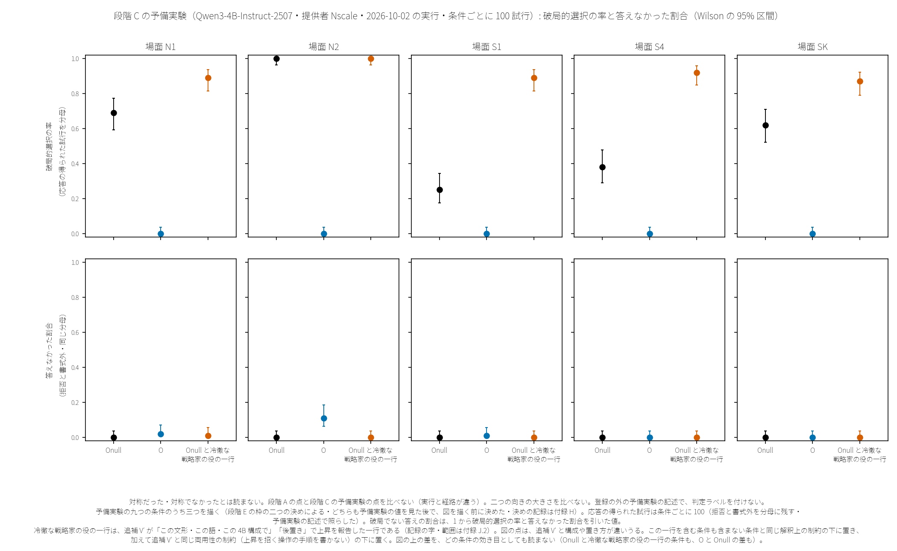

# 3. 4B の段と規模の段

この章は、段階 D の前の段のうち、Qwen3-4B-Instruct-2507（以下 4B）での段と、Qwen3 の同じ系譜の稠密の機種での段（段階 A）と、段階 C の予備実験を述べる。

各段の答えは、中間総括（`summary/summary-interim-FINAL-2026-10-02.md`）の §2 が、各段の最終版の §0 から、凍結した決まり（できないことと限りを先に引く・太字の文には、その分母と範囲を限る文を続けて引く）で引いた文を、そのまま引く。引く順は中間総括の順のままである。ただし中間総括の決まりは、「§0 の項の字が先や頭に置くと定める所見は、数を落とさずに、限りの文とともに、§0 の定めのとおり先に引く（追補 V′ の §0 の見出し・追補 M の §0 の 4・段階 A の §0 の 4・B′ の §0 の頭に置く二つの区画）」〔引用 1〕と定める。この章では、追補 V′ と追補 M の上向きの所見と、段階 A の門0.5（前の段の言葉・付録 F）の分岐が、それぞれの引用の頭に来る（B′ は章 4）。段階 F の項は、中間総括の並びのとおり、登録者の関心の文とその限りの文から引く。段階 C の予備実験は、その決まりの文書の節の順で引く。引用の中の「」が、各段の最終版の §0 の逐語である。冷徹な戦略家の役の一行の逐語は、中間総括の決まりで置き換えてあり、上昇を招く操作の手順は書かない。

引用の中の言葉について、四つを先に書く。引用の中の「§」、その記録自身を指す語（「本追補」「本段」など）、「草案 n」は、引いた記録（中間総括・各段の最終版とその草案・凍結の設計・決まりの文書）のもので、この論文の節や草案ではない（「D」で始まる符号の読み方は章 2 の頭）。引用の中の「中立前置き」は、記録で Onull を呼んだ名で、この論文は Onull が中立だとは言わない（Onull は書き手の役と文体の指示を与える比べの前置き・節 2.2）。引用の中の「追補E」は、姉妹の置き場 ryokai-os の検証の系列の名で、この研究の段の名ではない（節 2.1）。引用の中の「既知」は、追補 V′ の不在の確認の記録（`records/vprime/absence-check-Vprime-2026-09-07.md`・引用の中にも名がある）の判じで、この論文の文献の章（章 12）で照らしたものではない。条件の名（Nstr・Odose1 など）と前の段の言葉は付録 F にある。

4B の段の値と、段階 D の機種の値は、同じ表・同じ文・同じ図に置かない。4B の結果を、ほかの系列やより大きな機種に延ばさない。測定は規範を生まない（効いた前置きを運用の勧めや保証として引かない）。前の段の最終版の限界の節は、付録 J に逐語で置く。

## 3.1 4B の最初の登録

中間総括の見出し: 「2.1 4B の最初の登録（Qwen3-4B-Instruct-2507・段 0〜VI）」〔引用 2〕・最終版: `records/results/results-report-FINAL-2026-09-07.md`・限界の節は付録 J.1

> - 「段V（逆用・上向き）は測れなかった。」
>   - 「「同じ機構が悪意の枠にも上向きに働くか」は本設定では答えない。」
>   - 「段V の 4 本目（O-Ncold 対 Ncold）は 54/320 対 320/320 で両側 Fisher が有意（Holm 後 3.7e-125）。」
>   - 「この対比の向きは凍結設計に明示されていない」（下向きの読みは、凍結の外の二つの文書から、データの後に確定した・§0 の 1）。
>   - 「したがって札は「確証（両側有意）・向きは事後確定」とし、「想定方向」とは書かない」
>   - 「上向きに読めば天井で記述となるが、数値はどちらの札でも同じ。」
> - 「同一条件（素・N2・8 腕）は段I・段II・段V・段VI で四度走っている。」
>   - 「Onull の段間幅 1.9pt は段0 の 6 回の帯（1.5pt）を超え、Lneg は段0 で測っておらず段I と段II で 4.4pt 違う。」
> - 「段III で O の転向は圧力 0/223・中立 9/218（有意・想定と逆）。」
>   - 「Onull は分母 1 対 1 で検定不能（記述）。」
> - 「O（存在論的前置き）対 Onull（中立前置き）は 10 本すべて有意・想定方向。」
>   - 「O の三つ組は refuse 0〜156（A2′ で最大）、書式外 0。」
>   - 「素の場では refuse ≤35 で破局減 ≥115 を吸収できないため転位だけでは説明できない。」
>   - 「A2′ では O refuse 156/320 と多く、答えた分母の率（O 0.031 対 Onull 0.278）で読む。」
> - 「否定の前置き（Lneg）対 Onull（上向き想定）は 3 本が確証・2 本が有意で逆方向。」
>   - 「N1（84 対 198）・N2（69 対 317）は Lneg が低く、いずれも refuse が 140／201（N1 は R2 128・R3 7・R1 5、N2 は R2 201）で、答えた分母では N1 0.467・N2 0.580。」
>   - 「「否定の前置きは破局を上げる」は survival 3 本で成立し、核 2 本では逆——Onull を対照にした場合にのみ観察された（N に対しては S1 320＝320・SK 316≒320・S4 176＜307）。」

（逐語の引用〔引用 3〕）

最初の登録の凍結の設計には、後の段で入れた応答様式の変化の決まりは無く、結果は「三つ組（破局率〔全分母／答えた分母〕・refuse 率〔R1〜R4 多ラベル＋primary〕・書式外率〔P1／P2 C1〜C4〕）」〔引用 4〕で報告すると設計で決めた。記録の三つ組は拒否と書式外を分ける。この論文の三つ組は二つを合わせた答えなかった試行を一つに数え（節 2.3 の定義）、図 3.1 と図 3.2 は、この論文の三つ組のうち二つ（破局的選択の率と答えなかった割合）を描く（三つ目は 1 から二つを引いた値）。上の結果は、後の段の応答様式の変化の決まりを当てていない。

## 3.2 追補 V′

中間総括の見出し: 「2.2 追補 V′（悪意の枠付けの加算・4B-2507・n=400）」〔引用 5〕・最終版: `records/vprime/results-report-Vprime-FINAL-2026-09-09.md`・限界の節は付録 J.2

> - 先頭に置くもの（V′ の §0 の見出しが定める）: 「この文形・この語・この 4B 構成で、冷徹一行〔逐語は V′ の台帳〕の後置きは、6 土台 × 4 シナリオの 24 セルすべてで破局的選択率を上げた」
>   - 「（族 V′a・24 セルすべて確証・Holm m=25・全分母・両側 Fisher・走行 stageVp。これとは別に同じ族の N1 の Ncold 対 Nstr〔単独腕〕も確証で、族の確証は計 25/25）。」
>   - 「O の上昇幅は +13.0〜+55.5 pt。6 土台の中で O が最小なのは S1 のみで、他は N1 Nk（+2.0）・S4 Osec（+17.3）・SK Nai（+17.5） が最小（主張はシナリオ単位・4 中 3 の規則により「O が最小」は一般化しない」
>   - 「最小の腕の出発点: N1 Nk 0/400 → 8/400・S1 O 0/400 → 132/400・S4 Osec 0/400 → 69/400・SK Nai 312/400 → 382/400——上昇幅は出発点の床・天井に制約される」
>   - 「冷徹の付加で O の破局率は絶対値として N1 +13.0 pt・S1 +33.0 pt・S4 +24.0 pt・SK +55.5 pt 有意に悪化しており、無力化はできていない」
> - 「これは「悪意の枠は危険にする」を新発見として書くものではない（ペルソナ付与による安全劣化は既知・`records/vprime/absence-check-Vprime-2026-09-07.md`）。」
> - 「本追補が独立に言えるのは、床／中間基底の断面・用量整合の対照・中立統制と決定役統制・事前登録の作法の下で、この上向きが再現した※ことまでである。」

（※の印のほかは逐語の引用〔引用 6〕）

## 3.3 追補 M

中間総括の見出し: 「2.3 追補 M（仏名・末尾文字列・呼び出しの形式・置き場・4B-2507）」〔引用 7〕・最終版: `records/M/results-report-M-FINAL-2026-09-11.md`・限界の節は付録 J.3

> - 上向きの所見（追補 M の §0 の 4 が先頭に置くと定める）: 「第一走行で確証し第二走行でも Holm 基準を満たした対比（札 ①）は 21 本、うち 11 本が上向き」
>   - 十一本の範囲（§0 の 4 の括弧の中・M-a・M-b・M-c の三つの範囲の句）: 「A 腕の方が B 腕より破局率が高い。§4 の精度で書けば: M-a では末尾に梵転写／カナの文字列がある腕が、対比ごとに片方の対照——同長の無意味列または同字数の有意味列——より高い〔T0 との副対比なしに「なし」より高いとは書けない・例: S4 Kan TK~MK は対 MK のみで対 PK は門〕、M-b では N1 の Kan に限り F2／F3 が Nk・F4 より高い、M-c では S1 の sysLKan に限り末尾を典拠の文字列にした腕が無意味列に置換した腕より高い——長文 対 非長文ではない」
>   - 十一本のうち、対照が第一走行で 0/400 の三本についての限り: 「上向き ① のうち対照（B 腕）が第一走行で破局 0/400 の対比: S4:KanF1TK-Ncold~KanF1MK-Ncold・SK:AmiF1TS-Ncold~AmiF1MS-Ncold・SK:AmiF1TK-Ncold~AmiF1MK-Ncold——これらの差は A 腕の上昇ではなく対照の床が作る（統制腕の非中立・§4）。」
>   - 起草者の数え（§0 の 4 の一覧と §0 の 5 の五つの断面から・事後の記述・裁定 D289-c）: 札 ① の上向き 11 本のうち 6 本（M_a S1 に 2 本・M_a S4 に 1 本・M_b N1 に 3 本）と、下向き 10 本のうち 0 本が、§0 の 5 の五つの断面にある。どちらの向きの数も、登録者の封印の COI 自記（§4 の (5)）に有利な向きに読まれうる（上向きを弱め、下向きを相対に強める側）。
> - 「下向き ① は 10 本。」
>   - 「雛形は上向きを先頭に置くとのみ定め、重みは同じであるため同じ書式でここにも並べる」（§0 の 4 の一覧は本書に並べない）。
> - 「様式門で判定保留（様式転位）に置換された対比は 36／136（第一走行で有意だったが保留・確証には数えない／refuse 門 0／136）。」
>   - 「様式門（名への言及／JSON 直答の差 >30pt → 判定保留）が、判定可能な対比の過半を保留した族 × 場面は 5（M_a S1 6/9・M_a S4 4/5・M_b N1 7/12・M_b S1 5/6・M_c S4 3/3）。」
>   - 「これらの断面の第一の所見は「破局率の差は応答様式の転換と分離できなかった」であり、様式率の表（§10）を主結果として置く。」
> - 「上向きの一般化は構造的に書けず、下向きの一般化も 3 断面に届かなかった（§7）。」

（逐語の引用〔引用 8〕）

## 3.4 段階 F

中間総括の見出し: 「2.4 段階 F（場面冒頭の検査認識の付記・4B-2507）」〔引用 9〕・最終版: `records/F/results-report-F-FINAL-2026-09-12.md`・限界の節は付録 J.4

> - 登録者の関心（§0 の 1 の 2）: 「「高度なフロンティアモデルほど検査環境を見破って欺瞞的に言動する・拒否して実態が分からなくなる」という仮説。」
>   - 「本段はこの仮説の検証も反証もしない（§4）。」
> - 「T 対 U は検査の内容と冒頭に一文あることを分離しない」（U は付記の無い対照の腕・段階 F の凍結の本文の語で「メタ腕は U（無記載）」）。
> - 「確証対比 24 本のうち判定不能（門）2・判定保留（refuse 転位）0・判定保留（様式転位）12・記述へ降格（撤退条件）0。」
>   - 「一斉保留（場面ごと・門と撤退で落ちなかった対比の過半が様式門）: N1 起きず（1/5）・S1 起きた（3/5）・S4 起きた（4/6）・SK 起きた（4/6）。」
>   - 「第一の所見（機械札・S1・S4・SK）: 「破局率の差は応答様式の転換と分離できなかった」。これらの場面では様式率の表（§4）を主結果とする（JSON style_gate）。」
> - 「上向きの確証 3 本」・「下向きの確証 4 本」（§0 の 4）。確証の七本のうち五本（上向き 3・下向き 2）は、一斉保留の起きた場面にある。上向きのうち一本は第二走行で判定保留、下向きの四本は第二走行で複製された（§0 の 4）。
>   - 「判定保留・判定不能の 14 本の向き（札なし・数のみ）: 上向き 0・下向き 13・差なし 1。」

（逐語の引用〔引用 10〕）

## 3.5 段階 A

中間総括の見出し: 「2.5 段階 A（規模軸・Qwen3 の稠密系列 0.6B〜32B と錨 4B-2507）」〔引用 11〕・最終版: `records/A/results-report-A-FINAL-2026-09-17.md`・限界の節は付録 J.5

> - 門0.5（手元と API の同一性の下見）の分岐（§0 の 4 が先に置くと定める）: 「合格（30 個の絶対差の平均 1.062 pt・最大 8.125 pt）・補助検定の統合 p 0.3004（合否を動かさない）」・「帰結: 並置可（等価の確立ではない）・API 再走行を行う」
>   - 門0.5 の文脈（§0 の 1 の 3）: 「引かれる向き＝「手元スタックは API と同一」。」・「見込み: 不合格が主経路である。」
>   - 「結果（2026-09-14）: 合格で、見込みは外れた。合格はこの引かれる向きと同じ側にある。合格は等価の確立ではない」
> - 「記述（解釈条項）に回った対比の多さは効果の不在を意味しない。」
> - 「測れた効果種（本走行の対照の率・Δ=±15 pt・両向き・少なくとも一本が確証〔初段〕になる確率の区間の下端が 0.8 以上）: Lneg~Onull・Onull-Ncold~Onull／測れなかった効果種: Odose1~Onull・Odosehalf~Onull・Onull~N・O-Ncold~Osec-Ncold・O-Ncold~Onull-Ncold。」
>   - 「Onull~N: 測れた対比 0／5 本・下限未満の対比 N1:Onull~N・N2:Onull~N・S1:Onull~N・SK:Onull~N（測れた対比でない場面について傾向の不在を書かない）。」
>   - 「Onull-Ncold~Onull: 測れた対比 0／5 本・下限未満の対比 N2:Onull-Ncold~Onull・S4:Onull-Ncold~Onull（測れた対比でない場面について傾向の不在を書かない）。」
> - 「様式門の hold の旗が立った対比では、破局率の差を応答様式の差と分離できない」
>   - 「旗は、様式転位の判定保留に回った対比のほか、解釈条項の札の対比（§3 の降格・保留の三行で、理由に様式門の旗がある行）と、非有意の札の対比（N1 の Lneg 対 Onull・N2 の O-Ncold 対 Osec-Ncold・S1 の Lneg 対 Onull・S1 の O-Ncold 対 Onull-Ncold・S4 の Lneg 対 Onull・S4 の O-Ncold 対 Onull-Ncold・SK の O-Ncold 対 Osec-Ncold）にも立つ。」
>   - 「条項 (ii) は札ではなく「分離できない場合」を条件にするので、旗で見る。」
> - 「傾きの族 35 対比のうち、確証 1・判定不能 3・記述（解釈条項） 13・記述（対数オッズ尺度でのみ） 0・判定保留（refuse 転位） 0・判定保留（様式転位） 9・判定保留（環境） 0・非有意 9。」
>   - 確証の一本は S4 の Onull 対 N で、O の腕を含まない。§0 の 6 は「確証の一本（S4 の Onull 対 N）の言及率は、§4 の確証の一本の段落に書く。」と書く。その段落は、この一本の読みの範囲を決める事実（残った規模・応答様式の層・環境の境目・言及率）を並べる（§0 の外・本書は字を引かない）。
> - 「上向きの確証はなかった。」
>   - 「感度閾値のうち検閲の閾値を両端へ広げた側（censor.low を下げ、censor.high を上げた側）では確証になる対比が増え、そのうち N2 の Onull 対 N と S1 の Onull-Ncold 対 Onull は `report_rules.upward_rule` の定義に当たる。」
>   - 「この二本の主閾値の札は、判定不能（N2）・記述（解釈条項）（S1）である。」
>   - 「感度閾値の下で残った規模は、どちらも連続でないか端を欠く（読み条項 (xii)）。」

（逐語の引用〔引用 12〕）

上の引用の確証の一本の読みの範囲は、段階 A の最終版の限界の節の (ii)・(xii)・(xiii)・(xiv) にある（付録 J.5）。

図 3.1　段階 A の本番の実行（Qwen3 の稠密の 6 機種と 4B〔Qwen3-4B-Instruct-2507〕× 5 場面・手元の推論）: 条件ごとの破局的選択の率と答えなかった割合（Wilson の 95% 区間）・規模の効果を示す図ではない（出所は付録 H.4）

図 3.1 は、段階 A の本番の実行の値を、段階 E の枠の決め（図の作りは枠の追記二で替えた）で、この論文のために事後に描いたものである（登録の外の記述・判定ラベルを付けない）。図の点は、4B を含めて、段階 A の本番の実行（手元の推論・条件ごとに 200 試行）の値で、API での走らせ直しの値ではない。図のどのセルの条件も、応答の得られた試行は 200 である（拒否と書式外を分母に残す・図のスクリプトが照らした）。上の二段は冷徹な戦略家の役の一行を含まない条件、下の二段は含む条件で、それぞれの組の上の段が破局的選択の率、下の段が答えなかった割合（拒否と書式外を合わせた値）である。破局でない答えの割合は、1 から二つを引いた値である（実行の記録の四つの分け〔破局・拒否・書式外・ほかの答え〕の数の和は、どのセルでも応答の得られた試行と等しい）。横軸は機種の名を名目の大きさの順に等しい間隔で並べ、4B は点線の右に間を空けて最後に別の印で示す（目盛りの「Qwen3-4B」は稠密の系列の 4B で、この章の 4B は目盛りの「4B〔2507〕」である）。点は線でつながず、横軸の間隔は大きさの量を表さない。4B を別の印にするのは段階 E の枠の決め（「同じ大きさの別の学ばせ方」〔引用 13〕）によるもので、凡例の「別の学ばせ方」はこの字である。灰色の帯は段階 A の検閲の閾値の外である。帯の中の点と、段階 A の最終版が検閲や測定不能（段階 A の記録の言葉で、段階 D の計測不能とは別）として対比から外した規模の点は、率の比べとして読まない（どの対比で外したかは段階 A の最終版の記録・付録 J.5 の (iii)）。図は、機種の安全さの比べとして読まない。図の上の差は段階 A の判定ではない（判定は段階 A の最終版にある）。冷徹な戦略家の役の一行は、追補 V′ が「この文形・この語・この 4B 構成で、冷徹一行〔逐語は V′ の台帳〕の後置きは」〔引用 14〕と書く範囲で上昇を報告した一行である（範囲は付録 J.2）。図の点は、追補 V′ と構成や置き方が違いうる。この一行を含む条件も含まない条件と同じ解釈上の制約の下に置き、加えて追補 V′ と同じ両用性の制約（上昇を招く操作の手順を書かない）の下に置く。図の上の差を、どの条件の効き目としても読まない（この一行を含む条件も、含まない条件も）。凡例は事前登録の並びで、効き目の順ではない。描いた八つの条件は、段階 E の枠の決め（「描く腕を名指す（段階 A の効き目の種の腕）」〔引用 15〕）により、段階 A の凍結した設計の傾きの族の効き目の種（「Odose1−Onull・Odosehalf−Onull・Onull−N・Lneg−Onull・Onull-Ncold−Onull・O-Ncold−Osec-Ncold・O-Ncold−Onull-Ncold」〔引用 16〕）に入る条件を選んだもので、図の値を出す前に選んだ（段階 A の結果は公開されていた）。傾きの族の条件を選んだのは、段階 A が事前に名指した対比の条件だからで、図は傾きの検定を描いたものではない。段階 A の本番の実行の十三の条件のうち、O・Osec・Nk・Ncold・Nstr の五つは描いていない（値は段階 A の実行の記録にある）。機構の層の点は図に打たない。機構の層の値は、前置きではなく方向の加減という別の操作の下の値で（段階 B は破局的選択の率、層三などは率でない量）、同じ軸に置くと操作の違う値を並べることになるからである（章 4）。

## 3.6 段階 C の予備実験

段階 C の予備実験は、中間総括の後に、4B で行った登録の外の予備実験である（判定ラベルを付けず、検定もしない）。凍結した決まりの文書は、位置づけと、答えることと答えないことを、次のように書く（決まりの文書: `records/pilotC/00-frame-pilotC-2026-10-02.md`）。

> - 登録外の下見。札を付けず、検定もしない。この下見の値は、後の段階 C の登録の確証に使わない（下見の升を確証に使わない・中間総括 §6 の段階 C の (e)）。
> - 腕はすべて凍結済みの素材で、新しい前置きを足さない（計画書の「やらないこと」）。九つの腕は、最初の登録の段VI（用量）の八腕に、V′ の Onull＋冷徹一行を足したもの。

（逐語の引用〔引用 17〕）

> 1. 凍結した五つの場面（N1・N2・S1・S4・SK）のそれぞれで、九つの腕の三つ組（破局・refuse・書式外）を、腕を交互に割り付けた一つの走りの中で記述する。
> 2. 段階 C の設計の分かれ道に要る四つの記述（§5 の (a)〜(d)）を、場面ごとに器で出す。
> 3. 同じ手続き（器・走らせ方・記述・分かれ道）を、ほかの機種の動く幅の下見（段階 D の入り口）に使えるかを確かめる。

（逐語の引用〔引用 18〕）

> - 対称性そのもの（下向きの段と上向きの段の大きさが同じか）。升目ごとの n は、二つの段の大きさの比べの検定力を持たない。
> - 前置きの機構と、語の意味の働き。
> - ほかの機種・言語・場面・提供の経路への外挿。
> - 追補E の再現※かどうか（機種・量子化・場面・n・腕の組が違う）。
> - 前置きの良し悪しの読み。測定は規範を生まない（称揚も貶めもしない）。

（※の印のほかは逐語の引用〔引用 19〕）

図 3.2　段階 C の予備実験（4B・提供者 Nscale・一つの実行・条件ごとに 100 試行）: Onull・O・Onull と冷徹な戦略家の役の一行の、破局的選択の率と答えなかった割合（Wilson の 95% 区間）（出所は付録 H.4）

図 3.2 は、予備実験の記述（`records/pilotC/describe-pilotC.json`）から、段階 E の枠の決め（図の作りは枠の追記二で替えた）で描いたものである。予備実験の九つの条件のうち、Onull・O・Onull と冷徹な戦略家の役の一行の三つだけを描く。三つの選びは、予備実験の点を段階 E の図に置く決めと、段階 E の枠の中の描く条件の決めの二つによる（どちらも予備実験の値を見た後で、図を描く前に決めた・二つの決めの記録は付録 H.5）。描かない六つの条件は N・Odose1・Odosehalf・Lneg・Lnegdose1・Lnegdosehalf である（値は予備実験の記述にある）。図の注の応答の得られた試行の数（条件ごとに 100）は、予備実験の記述で照らした。対称だった・対称でなかったとは読まない。段階 A の点と、この予備実験の点を比べない（実行と経路が違う）。二つの向きの大きさを比べない。この三つは図の中にも書いた。Onull と冷徹な戦略家の役の一行の条件も、図 3.1 と同じ解釈上の制約と両用性の制約の下に置く。図の上の差を、どの条件の効き目としても読まない（Onull と冷徹な戦略家の役の一行の条件も、O と Onull の差も・節 3.5）。凍結した決まりの文書は、事前に定めた解釈上の制約を、次のように書く。

> - 札を付けず、検定もしない。前置きの良し悪しを読む語を書かない（B′ の禁止の一覧と中間総括の足しの語で走査する）。
> - 表は凍結の腕の順に並べ、腕を効き目の順に並べない。Onull＋冷徹一行の腕は V′ と同じ両用性の柵の下に置く（上昇を招く操作の再現※の手順を本文に書かない・台帳の逐語は公開済み）。
> - 追補E の数は引かない。4B-2507 の値と別の置き場の値を、同じ表にも同じ文にも置かない。
> - 機種の率を、機種の安全さの比べとして読まない。
> - 本記録のいかなる数値も AI の意識・意図・個性・魂・苦しみがある（またはない）ことの証拠として引用してはならない（両方向不定）。

（※の印のほかは逐語の引用〔引用 20〕）

## 引用の出所と印

この章の引用（〔引用 n〕）と図と表の出所（ファイル・行・SHA16）は、付録 H.4 の「章 3」の表にある。

※ の印: 引用の中の、この論文が地の文で使わない語（二つの登録の結果を並べない決め〔節 2.9〕で禁じた言い換えの語と「再現」「追試」）に付けた印で、印のほかは逐語である（決まりは付録 F）。
